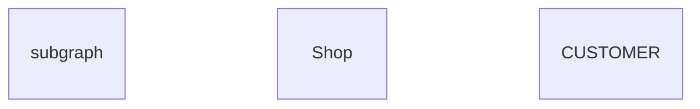
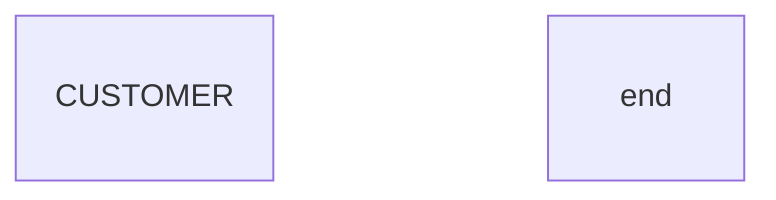
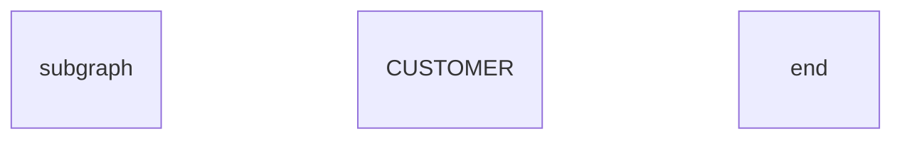
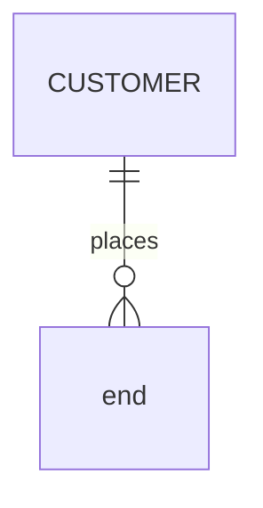

# ER errors: v12 and v13

## missing label

```mermaid
erDiagram
  CUSTOMER ||--o{ ORDER
```

v12:

```text
Parse error on line 2:
...USTOMER ||--o{ ORDER
-----------------------^
Expecting 'COLON', 'STYLE_SEPARATOR', got 'NEWLINE'
```

v13:

```text
Error at line 2, column 24: Expected `:` and a label, got a line break; write a relationship as `A ||--o{ B : label`, with a cardinality at each end and a label.
2 |   CUSTOMER ||--o{ ORDER
  |                        ^
Expected: `:` and a label
```

## missing cardinality

```mermaid
erDiagram
  CUSTOMER --o{ ORDER : places
```

v12:

```text
Parse error on line 2:
...rDiagram  CUSTOMER --o{ ORDER : places
----------------------^
Expecting 'EOF', 'NEWLINE', 'COLON', 'STYLE_SEPARATOR', 'BLOCK_START', 'SQS', 'SQE', 'title', 'acc_title', 'acc_descr', 'acc_descr_multiline_value', 'END', 'SUBGRAPH', 'direction_tb', 'direction_bt', 'direction_rl', 'direction_lr', 'CLASSDEF', 'UNICODE_TEXT', 'CLASS', 'STYLE', 'SEMI', 'NUM', 'ENTITY_NAME', 'DECIMAL_NUM', 'ENTITY_ONE', 'ZERO_OR_ONE', 'ZERO_OR_MORE', 'ONE_OR_MORE', 'ONLY_ONE', 'MD_PARENT', got 'IDENTIFYING'
```

v13:

```text
Error at line 2, column 12: Expected an entity name or a statement such as `style`, `classDef`, `class` or `subgraph`, got `--`.
2 |   CUSTOMER --o{ ORDER : places
  |            ^^
Expected: an entity name, a statement such as `style`, `classDef`, `class` or `subgraph`
```

## single-dash line

```mermaid
erDiagram
  CUSTOMER ||-o{ ORDER : places
```

v12:

```text
Parse error on line 2:
...iagram  CUSTOMER ||-o{ ORDER : places
----------------------^
Expecting 'NON_IDENTIFYING', 'IDENTIFYING', got 'UNICODE_TEXT'
```

v13:

```text
Error at line 2, column 14: Expected a line such as `--` or `..`, got `-o`; write a relationship as `A ||--o{ B : label`, with a cardinality at each end and a label.
2 |   CUSTOMER ||-o{ ORDER : places
  |              ^^
Expected: a line such as `--` or `..`
```

## cardinality word as a label

```mermaid
erDiagram
  CUSTOMER ||--o{ ORDER : one
```

v12:

```text
Parse error on line 2:
...OMER ||--o{ ORDER : one
-----------------------^
Expecting 'UNICODE_TEXT', 'ENTITY_NAME', 'WORD', got 'ONLY_ONE'
```

v13:

```text
Error at line 2, column 27: Expected a label such as `places` or `"places order"`, got `one`; write a relationship as `A ||--o{ B : label`, with a cardinality at each end and a label.
2 |   CUSTOMER ||--o{ ORDER : one
  |                           ^^^
Expected: a label such as `places` or `"places order"`
```

## missing end of a relationship

```mermaid
erDiagram
  CUSTOMER ||--o{ : places
```

v12:

```text
Parse error on line 2:
...m  CUSTOMER ||--o{ : places
----------------------^
Expecting 'UNICODE_TEXT', 'NUM', 'ENTITY_NAME', 'DECIMAL_NUM', 'ENTITY_ONE', 'NON_IDENTIFYING', 'IDENTIFYING', got 'COLON'
```

v13:

```text
Error at line 2, column 19: Expected an entity name, got `:`; write a relationship as `A ||--o{ B : label`, with a cardinality at each end and a label.
2 |   CUSTOMER ||--o{ : places
  |                   ^
Expected: an entity name
```

## unclosed attribute block

```mermaid
erDiagram
  CUSTOMER {
    string name
  ORDER
```

v12:

```text
Parse error on line 4:
...string name  ORDER
---------------------^
Expecting 'ATTRIBUTE_WORD', '?', got '1'
```

v13:

```text
Error at line 2, column 12: Unclosed attribute block: the `{` at line 2 has no closing `}`. Add `}` after the last attribute.
2 |   CUSTOMER {
  |            ^
Expected: an attribute type or name
Note at line 4, column 8: The text ends here.
4 |   ORDER
  |        ^
```

## attribute without a name

```mermaid
erDiagram
  CUSTOMER {
    string
  }
```

v12:

```text
Parse error on line 3:
...OMER {    string  }
---------------------^
Expecting 'ATTRIBUTE_WORD', '?', got 'BLOCK_STOP'
```

v13:

```text
Error at line 4, column 3: Expected an attribute type or name, got `}`; write each attribute as `type name`, e.g. `string name PK "comment"`.
4 |   }
  |   ^
Expected: an attribute type or name
```

## key without a separator

```mermaid
erDiagram
  CUSTOMER {
    string id PK FK
  }
```

v12:

```text
Parse error on line 3:
... {    string id PK FK  }
----------------------^
Expecting 'BLOCK_STOP', 'ATTRIBUTE_WORD', ',', 'COMMENT', got 'ATTRIBUTE_KEY'
```

v13:

```text
Error at line 3, column 18: Expected `,` between keys, e.g. `PK, FK`, got `FK`; write each attribute as `type name`, e.g. `string name PK "comment"`.
3 |     string id PK FK
  |                  ^^
Expected: `,` between keys, e.g. `PK, FK`
```

## unclosed alias

```mermaid
erDiagram
  CUSTOMER[Customer
  ORDER
```

v12:

```text
Parse error on line 2:
...  CUSTOMER[Customer  ORDER
----------------------^
Expecting 'SQE', got 'NEWLINE'
```

v13:

```text
Error at line 2, column 20: Expected `]`, got a line break; write an alias as `A[Alias]`, e.g. `CUSTOMER[Customer]`.
2 |   CUSTOMER[Customer
  |                    ^
Expected: `]`
```

## missing end



v12:

```text
Parse error on line 4:
...h Shop    CUSTOMER
---------------------^
Expecting 'EOF', 'NEWLINE', 'title', 'acc_title', 'acc_descr', 'acc_descr_multiline_value', 'END', 'SUBGRAPH', 'direction_tb', 'direction_bt', 'direction_rl', 'direction_lr', 'CLASSDEF', 'UNICODE_TEXT', 'CLASS', 'STYLE', 'NUM', 'ENTITY_NAME', 'DECIMAL_NUM', 'ENTITY_ONE', got '1'
```

v13:

```text
Error at line 2, column 12: Unclosed subgraph: the subgraph opened at line 2 has no `end`. Add `end` after its last statement.
2 |   subgraph Shop
  |            ^^^^
Expected: `end`
```

## stray end



v12:

```text
Parse error on line 3:
...iagram  CUSTOMER  end
---------------------^
Expecting 'EOF', 'NEWLINE', 'title', 'acc_title', 'acc_descr', 'acc_descr_multiline_value', 'SUBGRAPH', 'direction_tb', 'direction_bt', 'direction_rl', 'direction_lr', 'CLASSDEF', 'UNICODE_TEXT', 'CLASS', 'STYLE', 'NUM', 'ENTITY_NAME', 'DECIMAL_NUM', 'ENTITY_ONE', got 'END'
```

v13:

```text
Error at line 3, column 3: `end` without a `subgraph`: remove it, or open a subgraph before it with `subgraph <id>`.
3 |   end
  |   ^^^
```

## subgraph without an id



v12:

```text
Parse error on line 2:
erDiagram  subgraph    CUSTOMER  end
-------------------^
Expecting 'UNICODE_TEXT', 'NUM', 'ENTITY_NAME', 'DECIMAL_NUM', 'ENTITY_ONE', got 'NEWLINE'
```

v13:

```text
Error at line 2, column 11: Expected an entity name, got a line break; write it as `subgraph <id>` or `subgraph <id> [title]`, then statements and `end`.
2 |   subgraph
  |           ^
Expected: an entity name
```

## style without styles

```mermaid
erDiagram
  CUSTOMER
  style CUSTOMER
```

v12:

```text
Parse error on line 3:
...MER  style CUSTOMER
----------------------^
Expecting 'COLON', 'STYLE_TEXT', 'COMMA', 'NUM', 'BRKT', got 'NEWLINE'
```

v13:

```text
Error at line 3, column 17: Expected a style such as `fill:#f9f`, got a line break; write it as `style <entity> <styles>`, e.g. `style CUSTOMER fill:#f9f`.
3 |   style CUSTOMER
  |                 ^
Expected: a style such as `fill:#f9f`
```

## style with a dot

```mermaid
erDiagram
  CUSTOMER
  style CUSTOMER stroke-width:1.5px
```

v12:

```text
Lexical error on line 3. Unrecognized text.
...TOMER stroke-width:1.5px
-----------------------^
```

v13:

```text
Error at line 3, column 32: Unexpected character `.`; write it as `style <entity> <styles>`, e.g. `style CUSTOMER fill:#f9f`.
3 |   style CUSTOMER stroke-width:1.5px
  |                                ^
Expected: a line break or `;`, the end of the text
```

## class without a class

```mermaid
erDiagram
  CUSTOMER
  class CUSTOMER
```

v12:

```text
Parse error on line 3:
...MER  class CUSTOMER
----------------------^
Expecting 'UNICODE_TEXT', 'STYLE_TEXT', 'COMMA', got 'NEWLINE'
```

v13:

```text
Error at line 3, column 17: Expected a name, got a line break; write it as `class <entities> <class name>`, e.g. `class A,B hot`.
3 |   class CUSTOMER
  |                 ^
Expected: a name
```

## classes without a name

```mermaid
erDiagram
  CUSTOMER:::
```

v12:

```text
Parse error on line 2:
...iagram  CUSTOMER:::
----------------------^
Expecting 'UNICODE_TEXT', 'STYLE_TEXT', got 'NEWLINE'
```

v13:

```text
Error at line 2, column 14: Expected a name, got a line break.
2 |   CUSTOMER:::
  |              ^
Expected: a name
```

## unclosed description

```mermaid
erDiagram
  accDescr {
    A shop
  CUSTOMER
```

v12:

```text
Parse error on line 5:
...  A shop  CUSTOMER
---------------------^
Expecting 'EOF', 'NEWLINE', 'title', 'acc_title', 'acc_descr', 'acc_descr_multiline_value', 'END', 'SUBGRAPH', 'direction_tb', 'direction_bt', 'direction_rl', 'direction_lr', 'CLASSDEF', 'UNICODE_TEXT', 'CLASS', 'STYLE', 'NUM', 'ENTITY_NAME', 'DECIMAL_NUM', 'ENTITY_ONE', got '1'
```

v13:

```text
Error at line 2, column 3: Unclosed description: the `accDescr {` at line 2 has no closing `}`. Add `}` after the description.
2 |   accDescr {
  |   ^^^^^^^^^^
```

## keyword as a name



v12:

```text
Parse error on line 2:
...m  CUSTOMER ||--o{ end : places
----------------------^
Expecting 'UNICODE_TEXT', 'NUM', 'ENTITY_NAME', 'DECIMAL_NUM', 'ENTITY_ONE', 'NON_IDENTIFYING', 'IDENTIFYING', got 'END'
```

v13:

```text
Error at line 2, column 19: Expected an entity name, got `end`; write a relationship as `A ||--o{ B : label`, with a cardinality at each end and a label.
2 |   CUSTOMER ||--o{ end : places
  |                   ^^^
Expected: an entity name

Error at line 2, column 19: `end` without a `subgraph`: remove it, or open a subgraph before it with `subgraph <id>`.
2 |   CUSTOMER ||--o{ end : places
  |                   ^^^

Error at line 2, column 23: Expected an entity name or a statement such as `style`, `classDef`, `class` or `subgraph`, got `:`.
2 |   CUSTOMER ||--o{ end : places
  |                       ^
Expected: an entity name, a statement such as `style`, `classDef`, `class` or `subgraph`
```

## three mistakes

```mermaid
erDiagram
  A ||--o{ B
  C {
    int
  }
  style C
```

v12:

```text
Parse error on line 2:
...Diagram  A ||--o{ B  C {    int  } 
----------------------^
Expecting 'COLON', 'STYLE_SEPARATOR', got 'NEWLINE'
```

v13:

```text
Error at line 2, column 13: Expected `:` and a label, got a line break; write a relationship as `A ||--o{ B : label`, with a cardinality at each end and a label.
2 |   A ||--o{ B
  |             ^
Expected: `:` and a label

Error at line 5, column 3: Expected an attribute type or name, got `}`; write each attribute as `type name`, e.g. `string name PK "comment"`.
5 |   }
  |   ^
Expected: an attribute type or name

Error at line 6, column 10: Expected a style such as `fill:#f9f`, got a line break; write it as `style <entity> <styles>`, e.g. `style CUSTOMER fill:#f9f`.
6 |   style C
  |          ^
Expected: a style such as `fill:#f9f`
```
