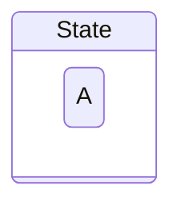

# State errors: v12 and v13

## missing header

```mermaid
A --> B
```

v12:

```text
No diagram type detected matching given configuration for text: A --> B
```

v13:

```text
Error at line 1, column 1: Expected `stateDiagram` or `stateDiagram-v2`, got `A`.
1 | A --> B
  | ^
Expected: `stateDiagram` or `stateDiagram-v2`
```

## dangling arrow

```mermaid
stateDiagram-v2
  A -->
```

v12:

```text
Parse error on line 2:
...teDiagram-v2  A -->
----------------------^
Expecting 'ID', 'EDGE_STATE', got 'NL'
```

v13:

```text
Error at line 2, column 8: Expected a state such as `A` or `[*]`, got a line break.
2 |   A -->
  |        ^
Expected: a state such as `A` or `[*]`
```

## arrow without a source

```mermaid
stateDiagram-v2
  --> B
```

v12:

```text
Parse error on line 2:
stateDiagram-v2  --> B
-----------------^
Expecting 'SPACE', 'NL', 'HIDE_EMPTY', 'scale', 'COMPOSIT_STATE', 'STATE_DESCR', 'ID', 'FORK', 'JOIN', 'CHOICE', 'CONCURRENT', 'note', 'acc_title', 'acc_descr', 'acc_descr_multiline_value', 'CLICK', 'classDef', 'style', 'class', 'direction_tb', 'direction_bt', 'direction_rl', 'direction_lr', 'EDGE_STATE', got '-->'
```

v13:

```text
Error at line 2, column 3: Expected a state such as `A` or `[*]`, a statement such as `state`, `note`, `classDef`, `class` or `style`, a line break or the end of the text, got `-->`; a transition starts at a state, e.g. `A --> B`.
2 |   --> B
  |   ^^^
Expected: a state such as `A` or `[*]`, a statement such as `state`, `note`, `classDef`, `class` or `style`, a line break, the end of the text
```

## single-dash arrow

```mermaid
stateDiagram-v2
  A -> B
```

v12:

```text
Parse error on line 2:
stateDiagram-v2  A -> B
-------------------^
Expecting 'SPACE', 'NL', 'DESCR', '-->', 'HIDE_EMPTY', 'scale', 'COMPOSIT_STATE', 'STRUCT_STOP', 'STATE_DESCR', 'ID', 'FORK', 'JOIN', 'CHOICE', 'CONCURRENT', 'note', 'acc_title', 'acc_descr', 'acc_descr_multiline_value', 'CLICK', 'STRING', 'HREF', 'classDef', 'style', 'class', 'direction_tb', 'direction_bt', 'direction_rl', 'direction_lr', 'EDGE_STATE', 'STYLE_SEPARATOR', got 'INVALID'
```

v13:

```text
Error at line 2, column 5: Unexpected character `-`; a transition is written `A --> B`.
2 |   A -> B
  |     ^
Expected: a state such as `A` or `[*]`, a statement such as `state`, `note`, `classDef`, `class` or `style`, a line break, the end of the text
```

## description without a state

```mermaid
stateDiagram-v2
  : waiting
```

v12:

```text
Parse error on line 2:
stateDiagram-v2  : waiting
-----------------^
Expecting 'SPACE', 'NL', 'HIDE_EMPTY', 'scale', 'COMPOSIT_STATE', 'STATE_DESCR', 'ID', 'FORK', 'JOIN', 'CHOICE', 'CONCURRENT', 'note', 'acc_title', 'acc_descr', 'acc_descr_multiline_value', 'CLICK', 'classDef', 'style', 'class', 'direction_tb', 'direction_bt', 'direction_rl', 'direction_lr', 'EDGE_STATE', got 'DESCR'
```

v13:

```text
Error at line 2, column 3: Expected a state such as `A` or `[*]`, a statement such as `state`, `note`, `classDef`, `class` or `style`, a line break or the end of the text, got `: waiting`; a description follows a state id, e.g. `A : waiting`.
2 |   : waiting
  |   ^^^^^^^^^
Expected: a state such as `A` or `[*]`, a statement such as `state`, `note`, `classDef`, `class` or `style`, a line break, the end of the text
```

## multi-word state name



v12:

```text
Error: State name must be a single word. Found: "Big State {"
```

v13:

```text
Error at line 2, column 9: A state name must be a single word, got `Big State`: write `state "Big State" as Big_State {` to show the words.
2 |   state Big State {
  |         ^^^^^^^^^
```

## described state without as

```mermaid
stateDiagram-v2
  state "Waiting for input"
  A
```

v12:

```text
Parse error on line 2:
...aiting for input"  A
----------------------^
Expecting 'AS', got 'ID'
```

v13:

```text
Error at line 2, column 27: Expected `as` and a state id, got the end of the line; write it as `state "<description>" as <id>`.
2 |   state "Waiting for input"
  |                           ^
Expected: `as` and a state id
```

## unclosed composite

```mermaid
stateDiagram-v2
  state Outer {
    A --> B
```

v12:

```text
Parse error on line 3:
...Outer {    A --> B
---------------------^
Expecting 'SPACE', 'NL', 'HIDE_EMPTY', 'scale', 'COMPOSIT_STATE', 'STRUCT_STOP', 'STATE_DESCR', 'ID', 'FORK', 'JOIN', 'CHOICE', 'CONCURRENT', 'note', 'acc_title', 'acc_descr', 'acc_descr_multiline_value', 'CLICK', 'classDef', 'style', 'class', 'direction_tb', 'direction_bt', 'direction_rl', 'direction_lr', 'EDGE_STATE', got '1'
```

v13:

```text
Error at line 2, column 15: Unclosed composite state: the `{` of `Outer` at line 2 has no closing `}`. Add `}` after its last statement.
2 |   state Outer {
  |               ^
Expected: `}`
Note at line 3, column 12: The text ends here.
3 |     A --> B
  |            ^
```

## brace after a plain id

```mermaid
stateDiagram-v2
  Outer {
    A
  }
```

v12:

```text
Parse error on line 2:
...eDiagram-v2  Outer {    A  }
----------------------^
Expecting 'SPACE', 'NL', 'DESCR', '-->', 'HIDE_EMPTY', 'scale', 'COMPOSIT_STATE', 'STRUCT_STOP', 'STATE_DESCR', 'ID', 'FORK', 'JOIN', 'CHOICE', 'CONCURRENT', 'note', 'acc_title', 'acc_descr', 'acc_descr_multiline_value', 'CLICK', 'STRING', 'HREF', 'classDef', 'style', 'class', 'direction_tb', 'direction_bt', 'direction_rl', 'direction_lr', 'EDGE_STATE', 'STYLE_SEPARATOR', got 'STRUCT_START'
```

v13:

```text
Error at line 2, column 9: Expected a state such as `A` or `[*]`, a statement such as `state`, `note`, `classDef`, `class` or `style`, a line break or the end of the text, got `{`; a composite state is written `state <id> {`.
2 |   Outer {
  |         ^
Expected: a state such as `A` or `[*]`, a statement such as `state`, `note`, `classDef`, `class` or `style`, a line break, the end of the text

Error at line 4, column 3: Expected a state such as `A` or `[*]`, a statement such as `state`, `note`, `classDef`, `class` or `style`, a line break or the end of the text, got `}`.
4 |   }
  |   ^
Expected: a state such as `A` or `[*]`, a statement such as `state`, `note`, `classDef`, `class` or `style`, a line break, the end of the text
```

## classDef default

```mermaid
stateDiagram-v2
  classDef default fill:#f96
```

v12:

```text
Parse error on line 2:
...agram-v2  classDef default fill:#f96
----------------------^
Expecting 'CLASSDEF_ID', 'DEFAULT', got 'DEFAULT_CLASSDEF_ID'
```

v13:

```text
Error at line 2, column 12: `classDef default` is not supported in state diagrams: give the class another name and apply it with `class`.
2 |   classDef default fill:#f96
  |            ^^^^^^^
```

## style without ids

```mermaid
stateDiagram-v2
  style "A" fill:red
```

v12:

```text
Lexical error on line 2. Unrecognized text.
...eDiagram-v2  style "A" fill:red
----------------------^
```

v13:

```text
Error at line 2, column 9: Unexpected character `"`; write it as `style <state ids> <styles>`, e.g. `style A fill:#f96`.
2 |   style "A" fill:red
  |         ^
Expected: state ids such as `A,B`
```

## class without ids

```mermaid
stateDiagram-v2
  class "A" hot
```

v12:

```text
Lexical error on line 2. Unrecognized text.
...eDiagram-v2  class "A" hot
----------------------^
```

v13:

```text
Error at line 2, column 9: Unexpected character `"`; write it as `class <state ids> <class name>`, e.g. `class A,B hot`.
2 |   class "A" hot
  |         ^
Expected: state ids such as `A,B`
```

## note without a side

```mermaid
stateDiagram-v2
  note A : hi
```

v12:

```text
Lexical error on line 2. Unrecognized text.
...teDiagram-v2  note A : hi
----------------------^
```

v13:

```text
Error at line 2, column 8: Unexpected character `A`; write it as `note left of <state> : <text>`, or `note right of <state>`, the text on the lines after it, then `end note`.
2 |   note A : hi
  |        ^
Expected: `left of` or `right of`, note text
```

## note with no end note

```mermaid
stateDiagram-v2
  note left of A
    some text
```

v12:

```text
Lexical error on line 2. Unrecognized text.
...-v2  note left of A    some text
----------------------^
```

v13:

```text
Error at line 2, column 3: Unclosed note: the note on `A` at line 2 has no text. Write it after `:` on the same line, or on the lines after it and end it with `end note`.
2 |   note left of A
  |   ^^^^
Note at line 2, column 17: The text ends here.
2 |   note left of A
  |                 ^
```

## scale without width

```mermaid
stateDiagram-v2
  scale 300
  A
```

v12:

```text
Lexical error on line 2. Unrecognized text.
...agram-v2  scale 300  A
----------------------^
```

v13:

```text
Error at line 2, column 12: Unexpected line break; write it as `scale <number> width`.
2 |   scale 300
  |            ^
Expected: a state such as `A` or `[*]`, a statement such as `state`, `note`, `classDef`, `class` or `style`, a line break, the end of the text
```

## click without a url

```mermaid
stateDiagram-v2
  A
  click A
```

v12:

```text
Parse error on line 3:
...ram-v2  A  click A
---------------------^
Expecting 'STRING', 'HREF', got 'NL'
```

v13:

```text
Error at line 3, column 10: Expected a quoted string, got a line break; write it as `click <state> "<url>" "<tooltip>"` or `click <state> href "<url>"`.
3 |   click A
  |          ^
Expected: a quoted string
```

## click with text after it

```mermaid
stateDiagram-v2
  A
  click A "https://example.com" "tip" B
```

v12:

```text
Parse error on line 3:
.../example.com" "tip" B
-----------------------^
Expecting 'NL', got 'ID'
```

v13:

```text
Error at line 3, column 39: Expected a line break, got `B`; write it as `click <state> "<url>" "<tooltip>"` or `click <state> href "<url>"`.
3 |   click A "https://example.com" "tip" B
  |                                       ^
Expected: a line break
```

## stray quoted string

```mermaid
stateDiagram-v2
  "A" --> B
```

v12:

```text
Parse error on line 2:
stateDiagram-v2  "A" --> B
-----------------^
Expecting 'SPACE', 'NL', 'HIDE_EMPTY', 'scale', 'COMPOSIT_STATE', 'STATE_DESCR', 'ID', 'FORK', 'JOIN', 'CHOICE', 'CONCURRENT', 'note', 'acc_title', 'acc_descr', 'acc_descr_multiline_value', 'CLICK', 'classDef', 'style', 'class', 'direction_tb', 'direction_bt', 'direction_rl', 'direction_lr', 'EDGE_STATE', got 'STRING'
```

v13:

```text
Error at line 2, column 3: Expected a state such as `A` or `[*]`, a statement such as `state`, `note`, `classDef`, `class` or `style`, a line break or the end of the text, got `"A"`; quoted text is a description, e.g. `state "Waiting" as W`.
2 |   "A" --> B
  |   ^^^
Expected: a state such as `A` or `[*]`, a statement such as `state`, `note`, `classDef`, `class` or `style`, a line break, the end of the text
```

## default as a statement

```mermaid
stateDiagram-v2
  default --> A
```

v12:

```text
Parse error on line 2:
stateDiagram-v2  default --> A
-----------------^
Expecting 'SPACE', 'NL', 'HIDE_EMPTY', 'scale', 'COMPOSIT_STATE', 'STATE_DESCR', 'ID', 'FORK', 'JOIN', 'CHOICE', 'CONCURRENT', 'note', 'acc_title', 'acc_descr', 'acc_descr_multiline_value', 'CLICK', 'classDef', 'style', 'class', 'direction_tb', 'direction_bt', 'direction_rl', 'direction_lr', 'EDGE_STATE', got 'DEFAULT'
```

v13:

```text
Error at line 2, column 3: Expected a state such as `A` or `[*]`, a statement such as `state`, `note`, `classDef`, `class` or `style`, a line break or the end of the text, got `default`; `default` is a keyword: use another state id.
2 |   default --> A
  |   ^^^^^^^
Expected: a state such as `A` or `[*]`, a statement such as `state`, `note`, `classDef`, `class` or `style`, a line break, the end of the text
```

## composite with two descriptions

```mermaid
stateDiagram-v2
  state "One" as X {
    A
  }
  X : Two
```

v12:

```text
Group nodes can only have label. Remove the additional description for node [X]
```

v13:

```text
Error at line 2, column 3: A composite state takes one description, and `X` has 2: remove the extra ones.
2 |   state "One" as X {
  |   ^^^^^^^^^^^^^^^^^^
```

## three mistakes

```mermaid
stateDiagram-v2
  A -> B
  state c d {
  }
  E -->
  F --> G
```

v12:

```text
Parse error on line 2:
stateDiagram-v2  A -> B  state c d { 
-------------------^
Expecting 'SPACE', 'NL', 'DESCR', '-->', 'HIDE_EMPTY', 'scale', 'COMPOSIT_STATE', 'STRUCT_STOP', 'STATE_DESCR', 'ID', 'FORK', 'JOIN', 'CHOICE', 'CONCURRENT', 'note', 'acc_title', 'acc_descr', 'acc_descr_multiline_value', 'CLICK', 'STRING', 'HREF', 'classDef', 'style', 'class', 'direction_tb', 'direction_bt', 'direction_rl', 'direction_lr', 'EDGE_STATE', 'STYLE_SEPARATOR', got 'INVALID'
```

v13:

```text
Error at line 2, column 5: Unexpected character `-`; a transition is written `A --> B`.
2 |   A -> B
  |     ^
Expected: a state such as `A` or `[*]`, a statement such as `state`, `note`, `classDef`, `class` or `style`, a line break, the end of the text

Error at line 3, column 9: A state name must be a single word, got `c d`: write `state "c d" as c_d {` to show the words.
3 |   state c d {
  |         ^^^

Error at line 5, column 8: Expected a state such as `A` or `[*]`, got a line break.
5 |   E -->
  |        ^
Expected: a state such as `A` or `[*]`
```
