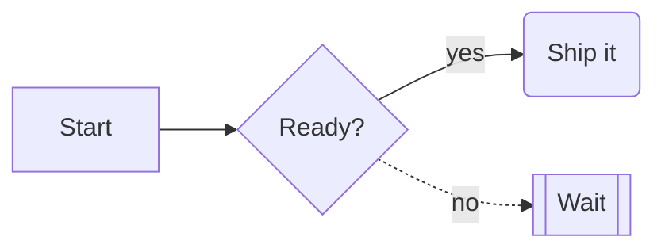
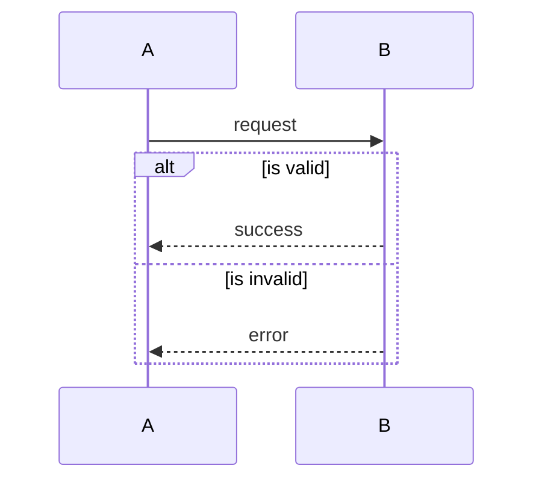
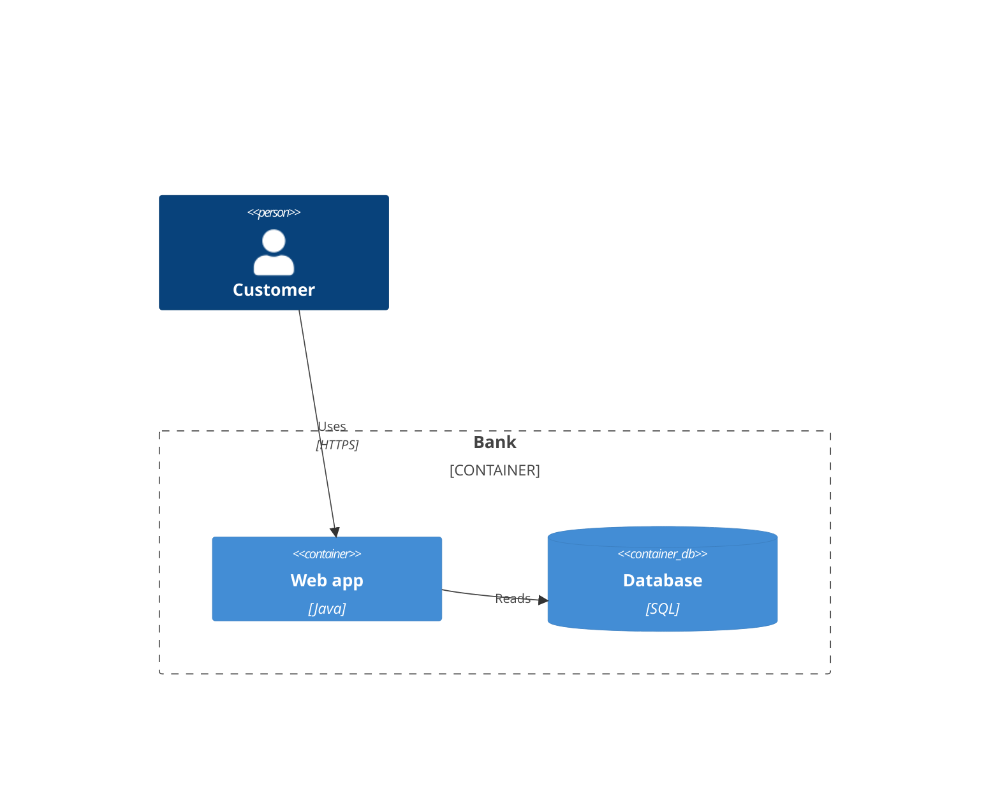
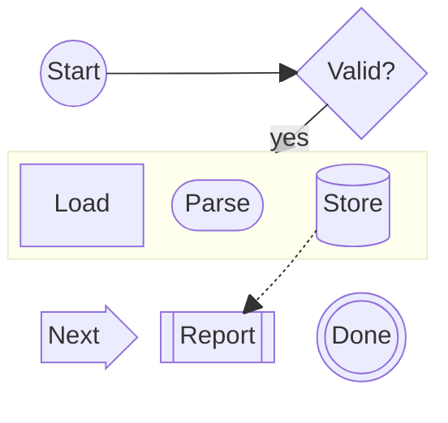
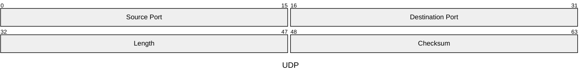
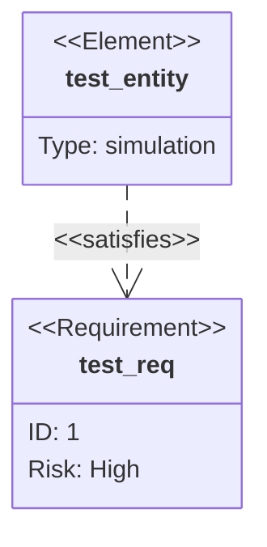
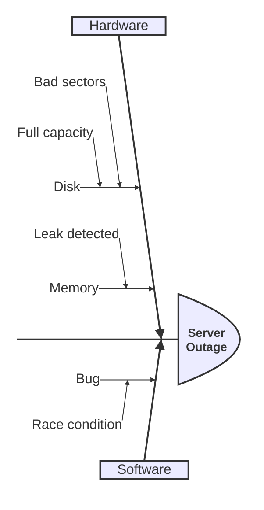

# ASCII output

Mermaid v13 can render a diagram as plain text instead of SVG: Unicode box drawing by default, or
pure ASCII. Text output runs the same parser and the same layout as SVG, laid out in character
cells instead of pixels, and is drawn by the diagram's own `ascii` entry (DESIGN §6.3, ADR-14).

Only diagram types that declare `ascii` in their manifest support it. In 13.0 those are the
flowchart (`graph` / `flowchart`), the ER diagram (`erDiagram`): entities are boxed tables,
relationships carry their cardinality marks at both ends (`||`, `|o`, `}|`, `}o`), the
sequence diagram (`sequenceDiagram`, [below](#sequence-diagrams)), the packet diagram (`packet`,
[below](#packet-diagrams)), the kanban board (`kanban`, [below](#kanban-boards)), the C4
diagram (`C4Context` and the other four headers, [below](#c4-diagrams)), the Ishikawa
diagram (`ishikawa`, [below](#ishikawa-diagrams)), the usecase
diagram (`usecase-beta`, [below](#usecase-diagrams)), the block diagram (`block`,
[below](#block-diagrams)) and `info`. See
[the format matrix](format-matrix.md) for every type.

```
               ┌───◇────┐            ╭─────────╮
┌───────┐      │        ├──── yes ──►│ Ship it │
│ Start ├─────►◇ Ready? ◇            ╰─────────╯
└───────┘      │        ├┄┄┐
               └───◇────┘  ┆
                           ┆
                           ┆         ╓──────╖
                           └┄ no ┄┄┄►║ Wait ║
                                     ╙──────╜
```

from



## API

Ask for text with `format: 'ascii'` in the render options (D80, R-ASCII-4):

```ts
import mermaid from 'mermaid';

const { text, columns, rows, warnings } = await mermaid.render('id', source, { format: 'ascii' });
```

`render` and `renderSync` return a `TextRenderResult` when `format` is `'ascii'`:

| Field         | Meaning                                                                       |
| ------------- | ----------------------------------------------------------------------------- |
| `format`      | Always `'ascii'`, whichever charset was used.                                 |
| `text`        | The drawing. Lines are separated by `\n`, have no trailing spaces, and are byte-stable. |
| `columns`     | Width of the widest line, in terminal cells (a CJK character counts 2).       |
| `rows`        | Number of lines.                                                              |
| `diagramType` | The detected type, as for SVG.                                                |
| `warnings`    | What could not be drawn (see [What gets dropped](#what-gets-dropped)).        |

- The overloads are typed on `format`: SVG calls (no options, `{ format: 'svg' }`, or v12's
  element argument) still return `RenderResult`. With a `format` only known at run time, narrow it
  before the call.
- `render`'s third argument may be an options object or, as in v12, a container element. An `id`
  in the options loses to `render`'s first argument.
- `config` in the options overrides the site config for this call, as for SVG.
- `renderSync(text, { format: 'ascii' })` needs the text entry loaded first. Call
  `await prepare(text, { format: 'ascii' })` (or `render` once). Before that, `renderSync` throws
  `NotLoadedError` for `flowchart/ascii`.
- Check support up front with `supportsFormat(type, 'ascii')`. Asking for text from a type that
  has no text form throws `UnsupportedFormatError` (code `UNSUPPORTED_FORMAT`) from `prepare`,
  `render` and `renderSync`. Mermaid never draws an approximation (D58).
- Syntax and other errors are the same `MermaidError`s as for SVG. There is no text error image.
- The DOM helpers (`run`, `mount`) stay SVG-only.

Text needs no theme and no browser: layout measures in cells with a built-in measurer, so the same
call works in Node, a worker or the browser.

Text output always lays out with the built-in `layered` engine, whatever `layout` says (D179):
no other engine knows cells. A diagram that names another layout (`layout: elk`, `elk.stress`,
the `flowchart-elk` header, a registered engine) is drawn as with `layered`, with one
`ASCII_DROPPED` warning (`feature: 'layout'`). That engine is never loaded for text, and there is
no `ELK_NOT_INSTALLED`, whether `@mermaid-js/layout-elk` is registered or not.

### Extensions

`postParse` and `postLayout` hooks run for text as for SVG. The layout a `postLayout` hook sees
has `units: 'cell'` (SVG: `'px'`), so a hook can tell cell coordinates from pixels. `postRender`
and `afterMount` do not run for text, and there is no text post-processing hook (D86).

## CLI

The `mermaid` package ships a zero-dependency `mermaid` command (D85):

```sh
mermaid render [file|-] --format ascii|svg [--charset unicode|ascii] [--width N|auto] [--warnings]
```

| Option                      | Meaning                                                                    |
| --------------------------- | -------------------------------------------------------------------------- |
| `file` or `-`               | The diagram to read. With no file, or `-`, it reads stdin.                 |
| `--format ascii\|svg`       | Required. `ascii` for text, `svg` for SVG. Output goes to stdout. Any other value is a usage error. |
| `--charset unicode\|ascii`  | Glyph set: Unicode box drawing (`unicode`, the default) or pure ASCII.     |
| `--width N`, `--width auto` | Fit the drawing to `N` columns (`ascii.maxWidth`); `auto` uses the terminal's width (`COLUMNS` off a terminal; no limit when neither is known). |
| `--warnings`                | Print warnings to stderr. Without it they are not printed.                 |
| `-h`, `--help`              | Print usage to stdout and exit 0.                                          |
| `-v`, `--version`           | Print the version to stdout and exit 0.                                    |

`--charset` and `--width` are explicit: each wins over the same key (`ascii.charset`,
`ascii.maxWidth`) set in the diagram's front matter or directives. Keys without a flag, such as
`ascii.padding`, come from the diagram as usual. The precedence, lowest first: defaults, the
diagram's front matter, its directives, the flags. The API offers the same through
`render(id, text, { format: 'ascii', ascii: { … } })`: keys in `ascii` win over every config
source, key by key.

Errors are printed to stderr with the source line and a caret under the problem (R-ERR-2).

| Exit code | When                                                                                   |
| --------- | -------------------------------------------------------------------------------------- |
| 0         | Rendered (or `--help`, `--version`).                                                   |
| 1         | Any error: a usage error (unknown option or command, a `--format` other than `ascii` or `svg`, a bad `--width` or `--charset`), syntax, unknown diagram, unreadable file. |
| 2         | The API's `UNSUPPORTED_FORMAT`: the diagram type has no form in the asked-for format.  |

Of the diagram types built into 13.0, the flowchart, the ER diagram, the sequence diagram,
the packet diagram, the kanban board, the C4 diagram, the Ishikawa diagram, the usecase diagram and the block diagram render as SVG and as text; the state diagram has no text form yet, so `--format ascii` on a
`stateDiagram` exits 2 (D58, D100).

No browser is involved: text is measured in cells, and SVG output measures with the built-in
font tables. It is not v12's `mmdc` (which renders through a headless browser) nor the
`mermaid-ascii` binary.

```sh
echo 'graph LR; a --> b' | mermaid render --format ascii
```

## Configuration

The `ascii` section (see [config reference](config-reference.md)). Diagram text may set every key,
in front matter or a directive. Unset keys use the defaults below; they are applied by the text
backend, so SVG renders and their ids do not change.

| Key              | Values                  | Default   | Effect                                                                                                                                                       |
| ---------------- | ----------------------- | --------- | ------------------------------------------------------------------------------------------------------------------------------------------------------------ |
| `ascii.charset`  | `unicode`, `ascii`      | `unicode` | Glyph set (D79).                                                                                                                                             |
| `ascii.padding`  | `compact`, `roomy`      | `compact` | `compact`: one cell of padding across a label, none down; gaps of 2 between nodes and 4 between ranks. `roomy`: one cell each way and gaps of 5, like mermaid-ascii (D77). |
| `ascii.maxWidth` | integer ≥ 1 (columns)   | none      | Columns to fit. Layout tightens first, then turns `LR` into `TB`. Output is never cropped: if it still does not fit, you get `ASCII_TOO_WIDE` (D84). |

```
---
config:
  ascii:
    charset: ascii
    maxWidth: 60
---
flowchart LR
  a --> b
```

px-valued keys such as `flowchart.nodeSpacing`, `rankSpacing` and `wrappingWidth` still count:
they convert at 8 × 16 px per cell, with minimums (200 px wrapping width → 25 cells). The px
`availableWidth` render option is ignored for text; use `ascii.maxWidth`.

ER is the exception for its size keys (D118): `er.nodeSpacing`, `er.rankSpacing` and
`er.minEntityWidth` convert only when the diagram, a directive or `initialize()` sets them.
v12's px defaults (140, 80, 100) do not convert: text output uses the cell profile's spacing and
fits each box to its text, with a rank gap of at least six cells so both cardinality marks of a
relationship and a line between them fit. `er.entityPadding` and `er.diagramPadding` are SVG
only (D116): cells keep their 1-cell padding and no margin. ER drawings do not yet fit
`ascii.maxWidth`.

## Glyph sets

| Element                     | `unicode`        | `ascii`          |
| --------------------------- | ---------------- | ---------------- |
| Solid line `-->`            | `─ │`            | `- \|`           |
| Dotted line `-.->`          | `┄ ┆`            | `. :`            |
| Thick line `==>`            | `━ ┃`            | `= I`            |
| Corners                     | `┌ ┐ └ ┘`        | `+`              |
| Thick corners               | `┏ ┓ ┗ ┛`        | `+`              |
| Arrowheads (up down left right) | `▲ ▼ ◄ ►`    | `^ v < >`        |
| Circle end `--o`            | `●`              | `o`              |
| Cross end `--x`             | `✕`              | `x`              |
| Edge leaving a box          | `┴ ┬ ┤ ├`        | `+`              |
| Crossings and junctions     | merged: `┼ ┿ ╪ …` | `+`             |

Where lines meet, the glyphs merge into one junction glyph, heavy and dashed lines included
(`─` over `│` is `┼`, `━` over `│` is `┿`). In `ascii` every corner, tee and crossing is `+`.

Text is laid out in terminal cells: East Asian wide and fullwidth characters and emoji take two
cells, combining marks none (D81). Each label line is one row. Markdown bullets are kept (`•` /
`◦`, `-` in `ascii`).

## Shapes

Every node is a box; the shape picks its corners, sides and side marks (D82). Shape delimiters
(`[` `]`, `(` `)`, `{` `}` …) never appear in the label.

| Shape                                              | `unicode`                      | `ascii`                 |
| -------------------------------------------------- | ------------------------------ | ----------------------- |
| rect `[a]`                                         | `┌─┐ └─┘`                      | `+-+`                   |
| rounded `(a)`, stadium `([a])`, circle `((a))`, ellipse | `╭─╮ ╰─╯`                 | `+-+`                   |
| diamond `{a}`                                      | box with `◇` at each side's middle | box with `*`        |
| hexagon `{{a}}`                                    | box with `<` and `>` on the left and right | same       |
| subroutine `[[a]]`                                 | double sides `║ ║`             | `I I`                   |
| cylinder `[(a)]`                                   | `═` top and bottom             | `=` top and bottom      |
| collapsed subgraph                                 | box with a `+` marker          | same                    |
| image, icon                                        | box with the label (asset dropped) | same                |
| any other shape                                    | plain box, `ASCII_SHAPE` warning | same                  |

Where an edge leaves a diamond at a side mark, the tee replaces the mark.

Subgraphs are frames with the title on the top border (`┌─ build ──┐`). Nested subgraphs nest.
An empty subgraph is drawn as an empty frame. A front-matter `title` is printed centred on the
first line.

## Sequence diagrams

The sequence diagram's text entry (`@mermaid-js/diagram-sequence/ascii`, D100) draws the same
layout as SVG, computed in cells (D108): one layout function, its lengths from a `cell` column
of the sequence metrics table.

```
  ┌───┐             ┌───┐
  │ A │             │ B │
  └─┬─┘             └─┬─┘
    ┆                 ┆
    ┆    request      ┆
    ├────────────────►┆
┌───┼ alt ────────────┼───┐
│   ┆      [is valid] ┆   │
│   ┆                 ┆   │
│   ┆    success      ┆   │
│   ┆◄┄┄┄┄┄┄┄┄┄┄┄┄┄┄┄┄┤   │
├┄┄┄┼┄┄┄┄┄┄┄┄┄┄┄┄┄┄┄┄┄┼┄┄┄┤
│   ┆  [is invalid]   ┆   │
│   ┆                 ┆   │
│   ┆     error       ┆   │
│   ┆◄┄┄┄┄┄┄┄┄┄┄┄┄┄┄┄┄┤   │
└───┼─────────────────┼───┘
    ┆                 ┆
  ┌─┴─┐             ┌─┴─┐
  │ A │             │ B │
  └───┘             └───┘
```

from



- Participants are boxes that fit their label, mirrored at the bottom as in SVG
  (`mirrorActors`). An `actor` has rounded corners and a `database` double top and bottom;
  the other symbols (boundary, control, entity, collections, queue) are plain boxes, named in
  one `ASCII_SHAPE` warning.
- Lifelines are dashed (`┆`, `:`). An activation draws its lifeline heavy (`┃`, `I`); a nested
  one is one column to the right.
- Message lines are solid or dotted and start at a tee on the sender's lifeline. Heads:
  `►` `◄` (`>` `<`) for `->>`, `✕` (`x`) for `-x`, `)` `(` for the async `-)`, harpoons
  `⇀` `⇁` `↼` `↽` for the half arrows, none for `->`. ASCII has no half heads: it draws
  them as `>` `<` and says so in one `ASCII_SHAPE` warning (`half-arrowhead`). A
  bidirectional arrow has a head at each end, a central connection `()` a circle (`●`, `o`)
  on the lifeline.
- A self message loops out right of its lifeline, its label beside it; a central circle sits
  where it leaves (`A()->>A`) or comes back (`A->>()A`). Every loop is square, so
  `sequence.rightAngles` changes nothing in text.
- Each line of a label is aligned as `sequence.messageAlign` / `noteAlign` say.
- Labels keep off the sides of a `box` group: a box grows to hold its members' self messages
  and notes, and a message label that would cross a side moves along its line to clear it.
- Notes are boxes; one over two participants fits its text. A fragment is a frame with its
  keyword on the top border (on the first stretch where no lifeline crosses it), its
  condition on the row below in brackets, and a dashed divider (`├┄┄┤`) before each `else`, `and` or
  `option`. A `box` group is a frame with its title on the top border.
- With `autonumber`, each label starts with its number (`1. Hello`), and the layout makes
  room for it.
- A `title` statement is centred above the drawing; without one, the front-matter title is.
- Dropped, one `ASCII_DROPPED` warning per kind: `style` (`box` colours and `rect`
  highlighting, which leaves no trace), `emphasis` (bold and italic text, and a bold
  `sequence.*FontWeight`), `link` (actor menus: `link`, `links`, `properties`,
  `details`) and `accessibility` (`accTitle`, `accDescr`).

`sequence.*` px config keys convert to cells as for the flowchart (8 × 16 px per cell): set
`sequence.width` to 120 and boxes are at least 15 columns wide. Wrapped text (`wrap`) wraps
to at least 19 columns.

## Kanban boards

The kanban board's text entry (`@mermaid-js/diagram-kanban/ascii`, #466, D320) draws the same
layout as SVG, computed in cells: one layout function, its lengths from a cell table of the
kanban metrics (`KANBAN_CELL_METRICS`), with `kanban.sectionWidth` converted to cells (200 px
is 25 columns).

```
┌──────── Todo ─────────┐ ┌──────── Done ─────────┐
│ ┎───────────────────┐ │ │                       │
│ ┃ Write the docs    │ │ └───────────────────────┘
│ ┃ MC-1         knsv │ │
│ ┖───────────────────┘ │
│ ┌───────────────────┐ │
│ │ Blog post         │ │
│ └───────────────────┘ │
└───────────────────────┘
```

- Columns are boxes side by side, one column apart, each `sectionWidth` wide, with its title
  centred on the top border; a longer title wraps and its later lines sit inside the box.
- Cards are boxes stacked inside their column, one column in from its sides. Titles, tickets and
  assignees wrap at the card's width less a space either side.
- A card's last row has the ticket on the left, as plain text (never a link), and the assignee
  on the right; when they do not fit side by side each takes a row of its own.
- The priority is the card's left edge: heavy (`┃`, `I`) for `Very High` and `High`, dashed
  (`┆`, `:`) for `Low` and `Very Low`. In the `ascii` charset a tag on the card's top border
  tells the four apart: `+-[!!]---+` (`Very High`), `[!]`, `[-]`, `[--]` (`Very Low`). Any other
  priority draws a plain edge and warns `KANBAN_PRIORITY`, as in SVG.
- A board wider than `ascii.maxWidth` is not folded: it is drawn whole, with `ASCII_TOO_WIDE`.
- Dropped, one `ASCII_DROPPED` warning per kind: `style` (`:::` classes), `emphasis` (bold and
  italic text) and `link` (ticket links from `kanban.ticketBaseUrl`). Column colours come from
  the theme and are dropped silently; icons are drawn by neither output.

## C4 diagrams

The C4 diagram's text entry (`@mermaid-js/diagram-c4/ascii`, #545, D459, D320) draws the SVG's
grid on a character grid: the same layout, with every text measured in cells of 8 × 16 px, divided
by the cell size.

```
╭─────────────────────────╮
│                         │
│                         │
│        Customer         │
│        [Person]         │
╰────────────────┬────────╯
                 │
                 │
               Uses
              [HTTPS]
┌┄┄┄┄┄┄┄┄┄┄┄┄┄┄┄┄┼┄┄┄┄┄┄┄┄┄┄┄┄┄┄┄┄┄┄ Bank ┄┄┄┄┄┄┄┄┄┄┄┄┄┄┄┄┄┄┄┄┄┄┄┄┄┄┄┄┄┄┄┄┄┄┄┄┐
┆                │                [CONTAINER]                                 ┆
┆                │                                                            ┆
┆                │                                                            ┆
┆                │                                                            ┆
┆                ▼                                                            ┆
┆      ╭─────────────────────────╮            ╒═════════════════════════╕     ┆
┆      │         Web app         │            │                         │     ┆
┆      │    [Container: Java]    ├── Reads ──►│        Database         │     ┆
┆      ╰─────────────────────────╯            │    [Container: SQL]     │     ┆
┆                                             │                         │     ┆
┆                                             ╘═════════════════════════╛     ┆
┆                                                                             ┆
┆                                                                             ┆
└┄┄┄┄┄┄┄┄┄┄┄┄┄┄┄┄┄┄┄┄┄┄┄┄┄┄┄┄┄┄┄┄┄┄┄┄┄┄┄┄┄┄┄┄┄┄┄┄┄┄┄┄┄┄┄┄┄┄┄┄┄┄┄┄┄┄┄┄┄┄┄┄┄┄┄┄┄┘
```

from



- Elements are boxes with their name, `[Kind]` and description centred, in the flowchart's text
  forms: rounded corners for systems, containers and people, caps for databases, double sides for
  a component frame (`$shape`), a square box for queues. A line wider than its box is cut with
  `…` (`...` in the `ascii` charset).
- Boundaries are dashed frames, deployment nodes solid ones, with the label in the top border and
  `[type]` and the description on the rows below.
- Relations are stepped lines routed on the grid round elements and header text, following the
  SVG's routed points where the grid allows; arrowheads at the ends that have them, a tee where
  one has none. The label and `[techn]` sit at or beside the middle of the line. With the root
  `wrap` and `c4.wrap` both set, as for the SVG, a label is wrapped narrower when the gap between
  two shapes is smaller than it; otherwise it stays on one line, cut with `…` where it still does
  not fit.
- The layout is the SVG's: a diagram wider than `ascii.maxWidth` is not folded, only warned about
  with `ASCII_TOO_WIDE`. `ascii.padding: roomy` adds a row round each element's text. A
  `c4ShapePadding` under 16 or a `c4ShapeMargin` under 32 leaves no room on the grid: it is raised,
  with `C4_CONFIG_IGNORED`.
- Config colours and fonts are ignored without a warning. Dropped, one `ASCII_DROPPED` warning per
  kind: `style` (`UpdateElementStyle` and `UpdateRelStyle` colours), `offset` (`$offsetX`,
  `$offsetY`), `tooltip` (a relation's description) and `accessibility` (`accTitle`, `accDescr`).

## Block diagrams

The block diagram's text entry (`@mermaid-js/diagram-block/ascii`, #559, D449) lays its own grid
out in cells from the model; the px layout is not read.

```
╭─────────╮                   ┌────◇────┐
│  Start  ├──────────────────►◇ Valid?  ◇
╰─────────╯                   └──┬─◇────┘
                             yes │
                                 ▼
┌──────────────── Work ─────────────────┐
│                                       │
│  ┌───────┐    ╭───────╮    ╒═══════╕  │
│  │ Load  │    │ Parse │  ┌┄┤ Store │  │
│  └───────┘    ╰───────╯  ┆ ╘═══════╛  │
│                          ┆            │
└──────────────────────────┼────────────┘
                           ┆
                           ┆
┌─────────┐    ╓─────────╖ ┆  ┌─────────┐
│  Next   ►    ║ Report  ║◄┘  │  Done   │
└─────────┘    ╙─────────╜    └─────────┘
```

from



- Blocks are boxes on a character grid, placed as in SVG (`columns`, spans, a block wider than
  the rest of its row). Every column of a grid is one width, its widest block's per column, so
  the widest label sets it; each row is as tall as its tallest block, and blocks fill their
  cells. Columns are four cells apart and rows two lines (`ascii.padding: roomy`: six and three,
  with a blank line above and below each label).
- A composite is a frame around its own grid, its label centred on the top border
  (`┌─ Work ─┐`). A frame grows to hold its widest row, so no block crosses it.
- A space keeps its cells and draws nothing; a row of spaces alone takes no room.
- Labels longer than 40 cells are cut with `…` (`~` in ASCII); with `ascii.maxWidth` labels are
  cut shorter, down to two cells, until the drawing fits. One that still does not is drawn
  whole, with `ASCII_TOO_WIDE`.
- Shapes take flowchart's text forms: rounded corners for round, circle and stadium, `◇` side
  marks for a diamond, `<` `>` for a hexagon, double sides for a subroutine, `═` caps for a
  cylinder. Double circles, the odd shape, the leans and the trapezoids are plain boxes, named in
  one `ASCII_SHAPE` warning.
- A block arrow is a box with an arrowhead in the middle of each side it points to (`right` `►`,
  `x` both `◄` and `►`, `y` both `▲` and `▼`). Lines never leave a block arrow at its arrowhead.
- Edges are stepped lines that leave a block at a tee and end in an arrowhead next to the other,
  `✕` for `--x` and `●` for `--o`; thick edges are heavy (`━`, `=`), dotted ones dashed (`┄`,
  `.`). They go round blocks, cross frames straight through and other lines only at right
  angles; an edge to a composite holding its other block ends inside the frame. No arrowhead or
  label sits on a frame. A self-loop leaves one side and comes back into the next one round.
  An edge no free route is found for is drawn across what is there, with `ASCII_ROUTE`.
- An edge label is written on its line where the line runs straight and has room for it, else on
  free cells beside the line.
- `block.padding` is pixel geometry: text ignores it, with no warning (D449). The composites'
  palette and other theme colours are dropped silently.
- Dropped, one `ASCII_DROPPED` warning per kind: `style` (`style`, `classDef`, `class`) and
  `emphasis` (bold and italic text).

## Usecase diagrams

The usecase diagram's text entry (`@mermaid-js/diagram-usecase/ascii`, #569, D320, D478) draws
the same graph as SVG, laid out in cells with `layered` (any other `layout` warns
`ASCII_DROPPED` `layout`, as for every graph type).

```
             ┌───── Shop ────┐
             │               │
             │   ╭───────╮   │                    ╭──────╮
      ┌──────┼──►( Login )┄┄┄┼┄┄┄┄┄┄┄ «include» ┄►( Auth )
  O   │      │   ╰───────╯   │                    ╰──────╯
 /|\──┘      │               │
 / \         └───────────────┘
User──┐
      │
      │ ╭─────────────────────────╮
      └►( Pay for the whole order )
        (    with a saved card    )
        ╰─────────────────────────╯
```

- Actors are a three-line figure (` O `, `/|\`, `/ \`) with the stereotype and the name under
  it; a line across runs up to the figure or the name.
- Use cases are boxes, rounded for an oval, whose label rows read `( label )` (`[ label ]` for a
  rect); a stereotype is a line over the label. The top and bottom rows give a line from the side
  a cell of its own off the corners.
- Boundaries (`package` ones too) are frames with the title in the top border; notes are boxes
  on a dotted line; JSON tables are key/value boxes, a divider between the columns.
- Include and extend are dotted, labelled `«include»` and `«extend»` (`<<include>>`,
  `<<extend>>` in the `ascii` charset, as stereotypes); generalization ends in `▷` (`|>`, or `-`
  over `v` across a vertical line); association ends are `►`, `●` and `✕` (`>`, `o`, `x`).
- `usecase.*` px lengths convert to cells only when set (8 × 16 px a cell; `nodeSpacing`,
  `rankSpacing`, `wrappingWidth`, `minNodeWidth`); the defaults give the cell profile's own.
- Dropped, one `ASCII_DROPPED` warning per kind: `style` (`style`, `classDef`, `class`),
  `emphasis`, `glyph` (business marks, icons and the hollow and awesome figures, drawn as the
  plain figure and boxes), `animation`, `config` (the `usecase` fonts, `colorScheme`,
  `useMaxWidth` and `diagramPadding` set off their defaults) and `accessibility`.

## Packet diagrams

The packet diagram's text entry (`@mermaid-js/diagram-packet/ascii`, D347) draws from the bit
grid itself, not from the SVG layout: each bit is two columns, so 32 bits a row give 65.

```
 0                            15 16                           31
┌───────────────────────────────┬───────────────────────────────┐
│          Source Port          │       Destination Port        │
└───────────────────────────────┴───────────────────────────────┘
 32                           47 48                           63
┌───────────────────────────────┬───────────────────────────────┐
│            Length             │           Checksum            │
└───────────────────────────────┴───────────────────────────────┘
                               UDP
```

from



- Each row is a run of boxes sharing their borders. With `packet.showBits: false` the rows share
  theirs too and make one table; with bit numbers on (the default) a line of them sits above
  each row, so the rows stand apart.
- The bit numbers are where the SVG puts them: a field's first bit from its first cell and its
  last bit up to its last cell, or a one-bit field's bit centred over its cell. Two bits are
  only four columns, so numbers can collide: read left to right, a number that would touch or
  overlap the one drawn before it (no blank column between them) is left out, so two never
  read as one (`1011`). The first number of a row is always drawn. From bit 10 on, a run of
  one-bit fields shows every other number; a two-bit field from bit 10 on shows only its first.
- `ascii.padding: roomy` puts a blank line above and below each label; `compact` (the default)
  has none. The columns stay two a bit either way (D347), so `roomy` adds no room across.
- A label is centred in its field and cut to it with `…` (`~` in ASCII); a split field's
  label is in each of its pieces. Labels and the title go through the same label layout as
  SVG, so entities decode, and a label's `<br>` lines join with a space.
- `packet.bitOrder: descending` mirrors the rows, bit 0 on the right, as in SVG.
- The title (the `title` statement, else the front-matter one) is centred under the rows.
- `rowHeight`, `bitWidth`, `paddingX` and `paddingY` are pixel geometry: text ignores them, with
  no warning. The width is bounded by `bitsPerRow`: the boxes take at most
  `2 × bitsPerRow + 1` columns (fewer when the fields stop short of a full row), and only a long
  title or a long bit number at a row's end goes past. A drawing wider than `ascii.maxWidth` is
  not cropped and warns `ASCII_TOO_WIDE`.
- Dropped, one `ASCII_DROPPED` warning per kind: `emphasis` (bold and italic labels and title)
  and `accessibility` (`accTitle`, `accDescr`).

## Requirement diagrams

The requirement diagram's text entry (`@mermaid-js/diagram-requirement/ascii`, #588, D438) lays
the diagram out in cells with the same layout as SVG, after the ER diagram's.

```
┌──────────────────┐
│   <<Element>>    │
│   test_entity    │
├──────────────────┤
│ Type: simulation │
└─────────┬────────┘
          ┆
          ┆
          ┆
    <<satisfies>>
          ┆
          ┆
          ▼
 ┌─────────────────┐
 │ <<Requirement>> │
 │    test_req     │
 ├─────────────────┤
 │ ID: 1           │
 │ Risk: High      │
 └─────────────────┘
```

from



- Each requirement and element is a box: `<<Kind>>` and the name centred, a divider, then one
  `Key: value` line per field that has a value. A value longer than 40 columns is cut to 40,
  the last an ellipsis (`…`, `~` in `ascii`); names are never cut.
- Relations are lines labelled `<<kind>>`: solid for `contains`, dotted for the others.
  `contains` is marked `⊕` (`(+)` in `ascii`) where it leaves its source; the others end in an
  arrowhead at the target.
- A drawing wider than `ascii.maxWidth` is drawn whole, with `ASCII_TOO_WIDE`.
- Dropped, one `ASCII_DROPPED` warning per kind: `style` (`style`, `classDef`, `class`),
  `curve` (a `flowchart.curve` other than `step`, `stepBefore` or `stepAfter`), `emphasis`
  (bold and italic text) and `accessibility` (`accTitle`, `accDescr`).

## Ishikawa diagrams

The Ishikawa diagram's text entry (`@mermaid-js/diagram-ishikawa/ascii`, #586, D498) draws an
outline, not the fishbone: the effect in a box, and the causes below it as a `tree(1)`-style tree
hanging from the box, in source order, with no left or right sides.

```
┌───────────────┐
│ Server Outage │
└─┬─────────────┘
  ├── Hardware
  │   ├── Disk
  │   │   ├── Bad sectors
  │   │   └── Full capacity
  │   └── Memory
  │       └── Leak detected
  └── Software
      └── Bug
          └── Race condition
```

from



- The connectors are `tree(1)`'s: `├── `, `└── ` for the last cause under its parent, and `│   `
  for the trunk past it; in the `ascii` charset `|-- `, `` `-- `` and `|   `.
- Every label is one line of plain text, as the SVG's `<title>`: entities decode, markup goes
  and a `<br>` reads as a space. Labels never wrap and the outline is never folded: wider than
  `ascii.maxWidth`, it is drawn whole, with `ASCII_TOO_WIDE`.
- The front-matter `title` is centred on the first line, on one line. An empty body (no effect)
  is the title line alone, or no text without a title, as the SVG draws nothing, with the same
  `ISHIKAWA_EMPTY` warning.
- The pixel geometry (`ishikawa.diagramPadding`) is ignored, with no warning.
- Dropped, one `ASCII_DROPPED` warning per kind: `emphasis` (bold and italic labels, drawn
  plain), `math` (`$$…$$`, the TeX shown as written) and `icon` (`fa:fa-…`, shown as written).

## What gets dropped

Text output is plain: no colour. Features with no text form are left out, with **one**
`ASCII_DROPPED` warning per kind. Each warning has `feature` and `astIds`, the AST ids of the
elements and statements involved, so an editor can point at them (D82, R-ASCII-5).

| `feature`       | What is dropped                                                  |
| --------------- | ---------------------------------------------------------------- |
| `style`         | Colours and styles: `style`, `classDef`, `class`, `linkStyle`.   |
| `curve`         | Edge curves; edges are always drawn as straight, stepped lines. |
| `image`         | Images and icon shapes; the label is kept.                       |
| `icon`          | Label icons (`fa:fa-car`), shown as written ([Icons](icons.md)). |
| `emphasis`      | Bold and italic text.                                            |
| `link`          | `click` links, tooltips and callbacks.                           |
| `accessibility` | `accTitle` and `accDescr`.                                       |

The other text warnings (`ASCII_SHAPE` is D82's; `ASCII_ROUTE` comes from the repair router, D78):

| Code             | Fields            | When                                                                     |
| ---------------- | ----------------- | ------------------------------------------------------------------------ |
| `ASCII_SHAPE`    | `shapes`, `astIds` | Nodes with a shape that has no text form, drawn as plain boxes.          |
| `ASCII_ROUTE`    | `astIds`          | An edge the router could not give a free lane; it may touch another line or text (D78). |
| `ASCII_TOO_WIDE` |                   | The drawing is wider than `ascii.maxWidth` after fitting (D84).          |

## Size

The text entry is loaded only when text is asked for: an SVG render never fetches it. `core/ascii`
plus one diagram type's text entry (the flowchart's, the ER diagram's, the sequence diagram's, the
packet diagram's, the kanban board's, the C4 diagram's, the Ishikawa diagram's, the usecase
diagram's, the block diagram's or info's)
have their own budget of 15 KB gzip, East Asian width data included, outside the 80 KB R-PERF-1
budget for SVG (D87, R-ASCII-9). The 15 KB budget is soft: the bench's `ascii-size` gate measures
each type's text path and reports the largest (D130), but never fails. That an SVG render loads
no ascii module is a hard check (`packages/bench/src/ascii-size.spec.ts` in `pnpm test`).
