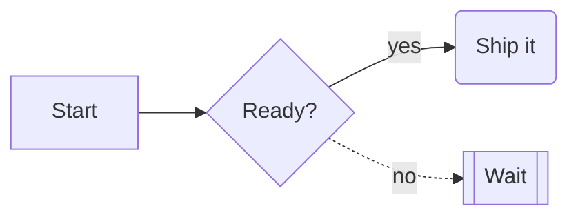

# ASCII output

Mermaid v13 can render a diagram as plain text instead of SVG: Unicode box drawing by default, or
pure ASCII. Text output runs the same parser and the same layout as SVG, laid out in character
cells instead of pixels, and is drawn by the diagram's own `ascii` entry (DESIGN §6.3, ADR-14).

Only diagram types that declare `ascii` in their manifest support it. In 13.0 that is the
flowchart (`graph` / `flowchart`). See [the format matrix](format-matrix.md) for every type.

```
               ┌───◇────┐            ╭─────────╮
┌───────┐      │        ├──── yes ──►│ Ship it │
│ Start ├─────►◇ Ready? ◇            ╰─────────╯
└───────┘      │        ├┄┄┐
               └───◇────┘  ┆
                           ┆
                           ┆         ╓──────╖
                           └┄ no ┄┄┄►║ Wait ║
                                     ╙──────╜
```

from



## API

Ask for text with `format: 'ascii'` in the render options (D80, R-ASCII-4):

```ts
import mermaid from 'mermaid';

const { text, columns, rows, warnings } = await mermaid.render('id', source, { format: 'ascii' });
```

`render` and `renderSync` return a `TextRenderResult` when `format` is `'ascii'`:

| Field         | Meaning                                                                       |
| ------------- | ----------------------------------------------------------------------------- |
| `format`      | Always `'ascii'`, whichever charset was used.                                 |
| `text`        | The drawing. Lines are separated by `\n`, have no trailing spaces, and are byte-stable. |
| `columns`     | Width of the widest line, in terminal cells (a CJK character counts 2).       |
| `rows`        | Number of lines.                                                              |
| `diagramType` | The detected type, as for SVG.                                                |
| `warnings`    | What could not be drawn (see [What gets dropped](#what-gets-dropped)).        |

- The overloads are typed on `format`: SVG calls (no options, `{ format: 'svg' }`, or v12's
  element argument) still return `RenderResult`. With a `format` only known at run time, narrow it
  before the call.
- `render`'s third argument may be an options object or, as in v12, a container element. An `id`
  in the options loses to `render`'s first argument.
- `config` in the options overrides the site config for this call, as for SVG.
- `renderSync(text, { format: 'ascii' })` needs the text entry loaded first. Call
  `await prepare(text, { format: 'ascii' })` (or `render` once). Before that, `renderSync` throws
  `NotLoadedError` for `flowchart/ascii`.
- Check support up front with `supportsFormat(type, 'ascii')`. Asking for text from a type that
  has no text form throws `UnsupportedFormatError` (code `UNSUPPORTED_FORMAT`) from `prepare`,
  `render` and `renderSync`. Mermaid never draws an approximation (D58).
- Syntax and other errors are the same `MermaidError`s as for SVG. There is no text error image.
- The DOM helpers (`run`, `mount`) stay SVG-only.

Text needs no theme and no browser: layout measures in cells with a built-in measurer, so the same
call works in Node, a worker or the browser.

### Extensions

`postParse` and `postLayout` hooks run for text as for SVG. The layout a `postLayout` hook sees
has `units: 'cell'` (SVG: `'px'`), so a hook can tell cell coordinates from pixels. `postRender`
and `afterMount` do not run for text, and there is no text post-processing hook (D86).

## CLI

The `mermaid` package ships a zero-dependency `mermaid` command (D85):

```sh
mermaid render [file|-] --format ascii|svg [--charset unicode|ascii] [--width N|auto] [--warnings]
```

| Option                      | Meaning                                                                    |
| --------------------------- | -------------------------------------------------------------------------- |
| `file` or `-`               | The diagram to read. With no file, or `-`, it reads stdin.                 |
| `--format ascii\|svg`       | Required. `ascii` for text, `svg` for SVG. Output goes to stdout. Any other value is a usage error. |
| `--charset unicode\|ascii`  | Glyph set: Unicode box drawing (`unicode`, the default) or pure ASCII.     |
| `--width N`, `--width auto` | Fit the drawing to `N` columns (`ascii.maxWidth`); `auto` uses the terminal's width (`COLUMNS` off a terminal; no limit when neither is known). |
| `--warnings`                | Print warnings to stderr. Without it they are not printed.                 |
| `-h`, `--help`              | Print usage to stdout and exit 0.                                          |
| `-v`, `--version`           | Print the version to stdout and exit 0.                                    |

`--charset` and `--width` are explicit: each wins over the same key (`ascii.charset`,
`ascii.maxWidth`) set in the diagram's front matter or directives. Keys without a flag, such as
`ascii.padding`, come from the diagram as usual. The precedence, lowest first: defaults, the
diagram's front matter, its directives, the flags. The API offers the same through
`render(id, text, { format: 'ascii', ascii: { … } })`: keys in `ascii` win over every config
source, key by key.

Errors are printed to stderr with the source line and a caret under the problem (R-ERR-2).

| Exit code | When                                                                                   |
| --------- | -------------------------------------------------------------------------------------- |
| 0         | Rendered (or `--help`, `--version`).                                                   |
| 1         | Any error: a usage error (unknown option or command, a `--format` other than `ascii` or `svg`, a bad `--width` or `--charset`), syntax, unknown diagram, unreadable file. |
| 2         | The API's `UNSUPPORTED_FORMAT`: the diagram type has no form in the asked-for format.  |

Exit 2 cannot happen with the diagram types built into 13.0: the flowchart, the only one, renders
both as SVG and as text. It is kept for types that will not have a text form (D58).

No browser is involved: text is measured in cells, and SVG output measures with the built-in
font tables. It is not v12's `mmdc` (which renders through a headless browser) nor the
`mermaid-ascii` binary.

```sh
echo 'graph LR; a --> b' | mermaid render --format ascii
```

## Configuration

The `ascii` section (see [config reference](config-reference.md)). Diagram text may set every key,
in front matter or a directive. Unset keys use the defaults below; they are applied by the text
backend, so SVG renders and their ids do not change.

| Key              | Values                  | Default   | Effect                                                                                                                                                       |
| ---------------- | ----------------------- | --------- | ------------------------------------------------------------------------------------------------------------------------------------------------------------ |
| `ascii.charset`  | `unicode`, `ascii`      | `unicode` | Glyph set (D79).                                                                                                                                             |
| `ascii.padding`  | `compact`, `roomy`      | `compact` | `compact`: one cell of padding across a label, none down; gaps of 2 between nodes and 4 between ranks. `roomy`: one cell each way and gaps of 5, like mermaid-ascii (D77). |
| `ascii.maxWidth` | integer ≥ 1 (columns)   | none      | Columns to fit. Layout tightens first, then turns `LR` into `TB`. Output is never cropped: if it still does not fit, you get `ASCII_TOO_WIDE` (D84). |

```
---
config:
  ascii:
    charset: ascii
    maxWidth: 60
---
flowchart LR
  a --> b
```

px-valued keys such as `flowchart.nodeSpacing`, `rankSpacing` and `wrappingWidth` still count:
they convert at 8 × 16 px per cell, with minimums (200 px wrapping width → 25 cells). The px
`availableWidth` render option is ignored for text; use `ascii.maxWidth`.

## Glyph sets

| Element                     | `unicode`        | `ascii`          |
| --------------------------- | ---------------- | ---------------- |
| Solid line `-->`            | `─ │`            | `- \|`           |
| Dotted line `-.->`          | `┄ ┆`            | `. :`            |
| Thick line `==>`            | `━ ┃`            | `= I`            |
| Corners                     | `┌ ┐ └ ┘`        | `+`              |
| Thick corners               | `┏ ┓ ┗ ┛`        | `+`              |
| Arrowheads (up down left right) | `▲ ▼ ◄ ►`    | `^ v < >`        |
| Circle end `--o`            | `●`              | `o`              |
| Cross end `--x`             | `✕`              | `x`              |
| Edge leaving a box          | `┴ ┬ ┤ ├`        | `+`              |
| Crossings and junctions     | merged: `┼ ┿ ╪ …` | `+`             |

Where lines meet, the glyphs merge into one junction glyph, heavy and dashed lines included
(`─` over `│` is `┼`, `━` over `│` is `┿`). In `ascii` every corner, tee and crossing is `+`.

Text is laid out in terminal cells: East Asian wide and fullwidth characters and emoji take two
cells, combining marks none (D81). Each label line is one row. Markdown bullets are kept (`•` /
`◦`, `-` in `ascii`).

## Shapes

Every node is a box; the shape picks its corners, sides and side marks (D82). Shape delimiters
(`[` `]`, `(` `)`, `{` `}` …) never appear in the label.

| Shape                                              | `unicode`                      | `ascii`                 |
| -------------------------------------------------- | ------------------------------ | ----------------------- |
| rect `[a]`                                         | `┌─┐ └─┘`                      | `+-+`                   |
| rounded `(a)`, stadium `([a])`, circle `((a))`, ellipse | `╭─╮ ╰─╯`                 | `+-+`                   |
| diamond `{a}`                                      | box with `◇` at each side's middle | box with `*`        |
| hexagon `{{a}}`                                    | box with `<` and `>` on the left and right | same       |
| subroutine `[[a]]`                                 | double sides `║ ║`             | `I I`                   |
| cylinder `[(a)]`                                   | `═` top and bottom             | `=` top and bottom      |
| collapsed subgraph                                 | box with a `+` marker          | same                    |
| image, icon                                        | box with the label (asset dropped) | same                |
| any other shape                                    | plain box, `ASCII_SHAPE` warning | same                  |

Where an edge leaves a diamond at a side mark, the tee replaces the mark.

Subgraphs are frames with the title on the top border (`┌─ build ──┐`). Nested subgraphs nest.
An empty subgraph is drawn as an empty frame. A front-matter `title` is printed centred on the
first line.

## What gets dropped

Text output is plain: no colour. Features with no text form are left out, with **one**
`ASCII_DROPPED` warning per kind. Each warning has `feature` and `astIds`, the AST ids of the
elements and statements involved, so an editor can point at them (D82, R-ASCII-5).

| `feature`       | What is dropped                                                  |
| --------------- | ---------------------------------------------------------------- |
| `style`         | Colours and styles: `style`, `classDef`, `class`, `linkStyle`.   |
| `curve`         | Edge curves; edges are always drawn as straight, stepped lines. |
| `image`         | Images and icons; the label is kept.                             |
| `emphasis`      | Bold and italic text.                                            |
| `link`          | `click` links, tooltips and callbacks.                           |
| `accessibility` | `accTitle` and `accDescr`.                                       |

The other text warnings (`ASCII_SHAPE` is D82's; `ASCII_ROUTE` comes from the repair router, D78):

| Code             | Fields            | When                                                                     |
| ---------------- | ----------------- | ------------------------------------------------------------------------ |
| `ASCII_SHAPE`    | `shapes`, `astIds` | Nodes with a shape that has no text form, drawn as plain boxes.          |
| `ASCII_ROUTE`    | `astIds`          | An edge the router could not give a free lane; it may touch another line or text (D78). |
| `ASCII_TOO_WIDE` |                   | The drawing is wider than `ascii.maxWidth` after fitting (D84).          |

## Size

The text entry is loaded only when text is asked for: an SVG render never fetches it. `core/ascii`
plus the flowchart's text entry have their own budget of 15 KB gzip, East Asian width data
included, outside the 80 KB R-PERF-1 budget for SVG (D87, R-ASCII-9). The bench checks both
(`ascii-size` gate; `packages/bench/src/ascii-size.spec.ts` in `pnpm test`).
