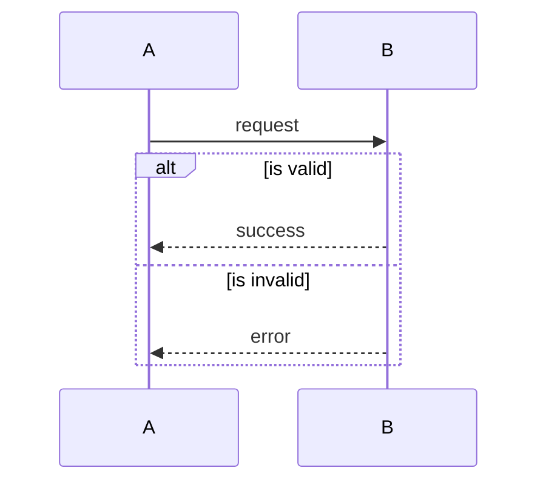

## Sequence diagrams

The sequence diagram's text entry (`@mermaid-js/diagram-sequence/ascii`, D100) draws the same
layout as SVG, computed in cells (D108): one layout function, its lengths from a `cell` column
of the sequence metrics table.

```
  ┌───┐             ┌───┐
  │ A │             │ B │
  └─┬─┘             └─┬─┘
    ┆                 ┆
    ┆    request      ┆
    ├────────────────►┆
┌───┼ alt ────────────┼───┐
│   ┆      [is valid] ┆   │
│   ┆                 ┆   │
│   ┆    success      ┆   │
│   ┆◄┄┄┄┄┄┄┄┄┄┄┄┄┄┄┄┄┤   │
├┄┄┄┼┄┄┄┄┄┄┄┄┄┄┄┄┄┄┄┄┄┼┄┄┄┤
│   ┆  [is invalid]   ┆   │
│   ┆                 ┆   │
│   ┆     error       ┆   │
│   ┆◄┄┄┄┄┄┄┄┄┄┄┄┄┄┄┄┄┤   │
└───┼─────────────────┼───┘
    ┆                 ┆
  ┌─┴─┐             ┌─┴─┐
  │ A │             │ B │
  └───┘             └───┘
```

from



- Participants are boxes that fit their label, mirrored at the bottom as in SVG
  (`mirrorActors`). An `actor` has rounded corners and a `database` double top and bottom;
  the other symbols (boundary, control, entity, collections, queue) are plain boxes, named in
  one `ASCII_SHAPE` warning.
- Lifelines are dashed (`┆`, `:`). An activation draws its lifeline heavy (`┃`, `I`); a nested
  one is one column to the right.
- Message lines are solid or dotted and start at a tee on the sender's lifeline. Heads:
  `►` `◄` (`>` `<`) for `->>`, `✕` (`x`) for `-x`, `)` `(` for the async `-)`, harpoons
  `⇀` `⇁` `↼` `↽` for the half arrows, none for `->`. ASCII has no half heads: it draws
  them as `>` `<` and says so in one `ASCII_SHAPE` warning (`half-arrowhead`). A
  bidirectional arrow has a head at each end, a central connection `()` a circle (`●`, `o`)
  on the lifeline.
- A self message loops out right of its lifeline, its label beside it; a central circle sits
  where it leaves (`A()->>A`) or comes back (`A->>()A`). Every loop is square, so
  `sequence.rightAngles` changes nothing in text.
- Each line of a label is aligned as `sequence.messageAlign` / `noteAlign` say.
- Labels keep off the sides of a `box` group: a box grows to hold its members' self messages
  and notes, and a message label that would cross a side moves along its line to clear it.
- Notes are boxes; one over two participants fits its text. A fragment is a frame with its
  keyword on the top border (on the first stretch where no lifeline crosses it), its
  condition on the row below in brackets, and a dashed divider (`├┄┄┤`) before each `else`, `and` or
  `option`. A `box` group is a frame with its title on the top border.
- With `autonumber`, each label starts with its number (`1. Hello`), and the layout makes
  room for it.
- A `title` statement is centred above the drawing; without one, the front-matter title is.
- Dropped, one `ASCII_DROPPED` warning per kind: `style` (`box` colours and `rect`
  highlighting, which leaves no trace), `emphasis` (bold and italic text, and a bold
  `sequence.*FontWeight`), `link` (actor menus: `link`, `links`, `properties`,
  `details`) and `accessibility` (`accTitle`, `accDescr`).

`sequence.*` px config keys convert to cells as for the flowchart (8 × 16 px per cell): set
`sequence.width` to 120 and boxes are at least 15 columns wide. Wrapped text (`wrap`) wraps
to at least 19 columns.
