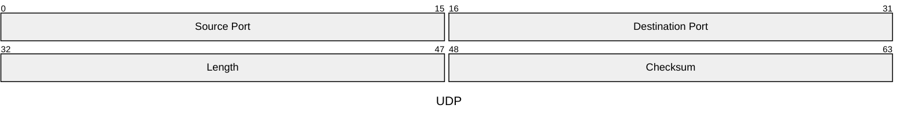

## Packet diagrams

The packet diagram's text entry (`@mermaid-js/diagram-packet/ascii`, D347) draws from the bit
grid itself, not from the SVG layout: each bit is two columns, so 32 bits a row give 65.

```
 0                            15 16                           31
┌───────────────────────────────┬───────────────────────────────┐
│          Source Port          │       Destination Port        │
└───────────────────────────────┴───────────────────────────────┘
 32                           47 48                           63
┌───────────────────────────────┬───────────────────────────────┐
│            Length             │           Checksum            │
└───────────────────────────────┴───────────────────────────────┘
                               UDP
```

from



- Each row is a run of boxes sharing their borders. With `packet.showBits: false` the rows share
  theirs too and make one table; with bit numbers on (the default) a line of them sits above
  each row, so the rows stand apart.
- The bit numbers are where the SVG puts them: a field's first bit from its first cell and its
  last bit up to its last cell, or a one-bit field's bit centred over its cell. Two bits are
  only four columns, so numbers can collide: read left to right, a number that would touch or
  overlap the one drawn before it (no blank column between them) is left out, so two never
  read as one (`1011`). The first number of a row is always drawn. From bit 10 on, a run of
  one-bit fields shows every other number; a two-bit field from bit 10 on shows only its first.
- `ascii.padding: roomy` puts a blank line above and below each label; `compact` (the default)
  has none. The columns stay two a bit either way (D347), so `roomy` adds no room across.
- A label is centred in its field and cut to it with `…` (`~` in ASCII); a split field's
  label is in each of its pieces. Labels and the title go through the same label layout as
  SVG, so entities decode, and a label's `<br>` lines join with a space.
- `packet.bitOrder: descending` mirrors the rows, bit 0 on the right, as in SVG.
- The title (the `title` statement, else the front-matter one) is centred under the rows.
- `rowHeight`, `bitWidth`, `paddingX` and `paddingY` are pixel geometry: text ignores them, with
  no warning. The width is bounded by `bitsPerRow`: the boxes take at most
  `2 × bitsPerRow + 1` columns (fewer when the fields stop short of a full row), and only a long
  title or a long bit number at a row's end goes past. A drawing wider than `ascii.maxWidth` is
  not cropped and warns `ASCII_TOO_WIDE`.
- Dropped, one `ASCII_DROPPED` warning per kind: `emphasis` (bold and italic labels and title)
  and `accessibility` (`accTitle`, `accDescr`).
