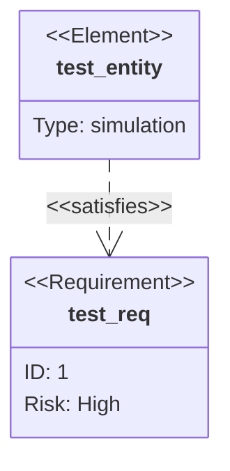

## Requirement diagrams

The requirement diagram's text entry (`@mermaid-js/diagram-requirement/ascii`, #588, D438) lays
the diagram out in cells with the same layout as SVG, after the ER diagram's.

```
┌──────────────────┐
│   <<Element>>    │
│   test_entity    │
├──────────────────┤
│ Type: simulation │
└─────────┬────────┘
          ┆
          ┆
          ┆
    <<satisfies>>
          ┆
          ┆
          ▼
 ┌─────────────────┐
 │ <<Requirement>> │
 │    test_req     │
 ├─────────────────┤
 │ ID: 1           │
 │ Risk: High      │
 └─────────────────┘
```

from



- Each requirement and element is a box: `<<Kind>>` and the name centred, a divider, then one
  `Key: value` line per field that has a value. A value longer than 40 columns is cut to 40,
  the last an ellipsis (`…`, `~` in `ascii`); names are never cut.
- Relations are lines labelled `<<kind>>`: solid for `contains`, dotted for the others.
  `contains` is marked `⊕` (`(+)` in `ascii`) where it leaves its source; the others end in an
  arrowhead at the target.
- A drawing wider than `ascii.maxWidth` is drawn whole, with `ASCII_TOO_WIDE`.
- Dropped, one `ASCII_DROPPED` warning per kind: `style` (`style`, `classDef`, `class`),
  `curve` (a `flowchart.curve` other than `step`, `stepBefore` or `stepAfter`), `emphasis`
  (bold and italic text) and `accessibility` (`accTitle`, `accDescr`).
