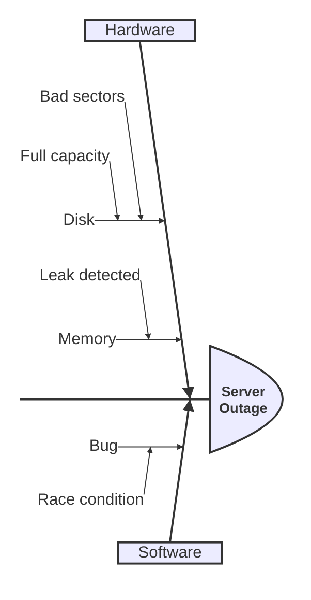

## Ishikawa diagrams

The Ishikawa diagram's text entry (`@mermaid-js/diagram-ishikawa/ascii`, #586, D498) draws an
outline, not the fishbone: the effect in a box, and the causes below it as a `tree(1)`-style tree
hanging from the box, in source order, with no left or right sides.

```
┌───────────────┐
│ Server Outage │
└─┬─────────────┘
  ├── Hardware
  │   ├── Disk
  │   │   ├── Bad sectors
  │   │   └── Full capacity
  │   └── Memory
  │       └── Leak detected
  └── Software
      └── Bug
          └── Race condition
```

from



- The connectors are `tree(1)`'s: `├── `, `└── ` for the last cause under its parent, and `│   `
  for the trunk past it; in the `ascii` charset `|-- `, `` `-- `` and `|   `.
- Every label is one line of plain text, as the SVG's `<title>`: entities decode, markup goes
  and a `<br>` reads as a space. Labels never wrap and the outline is never folded: wider than
  `ascii.maxWidth`, it is drawn whole, with `ASCII_TOO_WIDE`.
- The front-matter `title` is centred on the first line, on one line. An empty body (no effect)
  is the title line alone, or no text without a title, as the SVG draws nothing, with the same
  `ISHIKAWA_EMPTY` warning.
- The pixel geometry (`ishikawa.diagramPadding`) is ignored, with no warning.
- Dropped, one `ASCII_DROPPED` warning per kind: `emphasis` (bold and italic labels, drawn
  plain), `math` (`$$…$$`, the TeX shown as written) and `icon` (`fa:fa-…`, shown as written).
