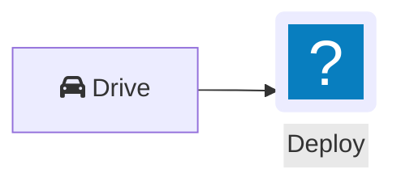

# Icons

Mermaid v13 draws icons from [Iconify](https://iconify.design/) JSON icon packs that you
register in code. The icons are drawn as SVG paths by the optional `@mermaid-js/plugin-icons`
package; diagram text only names them. Browse the packs at [icones.js.org](https://icones.js.org/).

Icons appear in two places:

- **In labels**, written `fa:fa-car`: the icon `car` from the pack registered as `fa`. Labels
  read the Font Awesome prefixes `fa`, `fab`, `fad`, `fak`, `fal`, `far` and `fas`, in every
  label Mermaid lays out (flowchart, class, state, ER and sequence). Other text with a colon,
  such as `note:item`, stays text.
- **In shapes**: flowchart icon shapes (`A@{ icon: "logos:aws", form: "square" }`) name any
  registered pack as `pack:name`.



(with `fa6-solid` registered as `fa` and `logos` as `logos`, below).

## Installing

```bash
npm install mermaid@v13-alpha @mermaid-js/plugin-icons@v13-alpha @iconify-json/logos
```

With the plugin installed, Node and bundlers using `@mermaid-js/bundler-plugin` turn it on by
themselves. Otherwise register it before the first render:

```js
import mermaid from 'mermaid';
import { icons } from '@mermaid-js/plugin-icons';

await mermaid.registerExternalDiagrams([icons]);
```

The plugin is an ES module that imports `@mermaid-js/core`: use it from npm, with a bundler or
in Node.

## Registering icon packs

The name a pack is registered under replaces the pack's own `prefix`, so you can give a pack a
shorter name. A pack behind a `loader` is loaded only when a diagram names it.

A pack from a CDN:

```js
mermaid.registerIconPacks([
  {
    name: 'logos',
    loader: () =>
      fetch('https://unpkg.com/@iconify-json/logos@1/icons.json').then((res) => res.json()),
  },
]);
```

A pack from npm, loaded lazily:

```js
mermaid.registerIconPacks([
  {
    name: 'logos',
    loader: () => import('@iconify-json/logos').then((module) => module.icons),
  },
]);
```

A pack from npm, bundled with the page:

```js
import { icons } from '@iconify-json/logos';

mermaid.registerIconPacks([
  {
    name: icons.prefix, // the prefix the pack defines
    icons,
  },
]);
```

Packs belong to the `mermaid` object you register them on: an API object from
`createMermaid()` has its own. Registering a name again replaces its pack.

### Font Awesome

Label icons are looked up in the pack registered under their prefix, so register one pack per
prefix your diagrams use:

```js
mermaid.registerIconPacks([
  { name: 'fa', loader: () => import('@iconify-json/fa6-solid').then((m) => m.icons) },
  { name: 'fab', loader: () => import('@iconify-json/fa6-brands').then((m) => m.icons) },
]);
```

Names are the pack's. `@iconify-json/fa6-solid` has Font Awesome 6 names, so `fa:fa-house`
resolves and `fa:fa-home` (its Font Awesome 5 name) does not. For Font Awesome 5 names, register
`@iconify-json/fa-solid` as `fa` instead. Font Awesome's CSS on the page does not draw icons.

## Rendering

`render()` loads the packs a diagram names before it draws. For `renderSync`, load them first:

```js
await mermaid.prepare(text); // loads what this diagram needs
// or, up front:
await mermaid.preload({ iconPacks: ['fa', 'logos'] });

const { svg } = mermaid.renderSync(text);
```

Without that, `renderSync` throws `NotLoadedError` naming the pack. With
`renderSync(text, { placeholders: true })` it draws an empty 1em box in place of each label icon
(an icon shape draws its frame, or nothing if it has no `form`) and warns `PLACEHOLDER`.

A label icon is 1em tall at the label's font size, as wide as its aspect makes it, its bottom
0.125em below the text's baseline, in the label's text colour. An icon shape's glyph takes the node's `stroke`
style, else the theme's node border colour; with `useGradient` (`neo`, `neo-dark`) and no `stroke`
style, its `currentColor` parts take the border gradient instead.

## When an icon is not drawn

Mermaid never fails a render over an icon. It reports a warning in `RenderResult.warnings`:

| Code | When |
| --- | --- |
| `ICON_NOT_RENDERED` | An icon did not resolve: no icons plugin, no pack of that name, no such icon, a pack whose loader failed or that is not Iconify JSON, or a shape icon name that is not `pack:name`. A label shows the icon as written (`fa:fa-car`); an icon shape draws its frame alone, or nothing if it has no `form`. One warning per render: with the icons plugin it names the icons and why; without it, it says icons need an icons extension. |
| `ICON_PACKS_UNSUPPORTED` | Packs are registered, but no icons plugin is. |
| `ICON_SIMPLIFIED` | An icon was drawn without parts Mermaid does not draw (below). One warning per render names the icons. |
| `ICON_UNAVAILABLE` | Deprecated, for flowchart icon shapes: read `ICON_NOT_RENDERED`. It is still raised next to it in this alpha. |
| `PLACEHOLDER` | `renderSync` with `placeholders: true` drew a placeholder for a pack not loaded yet. |

A loader that rejects does not fail the render: its icons are not drawn, the warning names the
pack and the loader's error, and the next `prepare()` or `render()` tries again.

## What an icon may contain

Icon packs are data, not markup: Mermaid rebuilds each icon from the shapes it allows, so a pack
cannot add script, links or styles to your page. An icon keeps `g`, `path`, `rect`, `circle`,
`ellipse`, `line`, `polyline`, `polygon` and `text` with their presentation attributes (fill,
stroke, opacity, `fill-rule`, `clip-rule`, transforms). It loses `defs`, gradients, masks, clip
paths, `use`, `style`, `image` and animation, and `url(#…)` paints become `currentColor`, with
`ICON_SIMPLIFIED`. No icon of `fa6-solid` or `mdi` loses anything; multi-colour packs such as
`logos` draw some icons (about one in five) flatter than the original.

## Text output

ASCII and Unicode output have no icons: a label shows them as written, with one `ASCII_DROPPED`
warning (`feature: 'icon'`), and an icon shape is a box with its label. See
[ASCII output](ascii.md).

## Mindmap

Mindmap is not ported to v13 yet. When it is, `::icon(fa fa-book)` and `::icon(mdi:fire)` draw
from the registered packs, and an icon that does not resolve is shown as written.

## Coming from v12

See [Icons in the migration guide](MIGRATION.md#icons).
